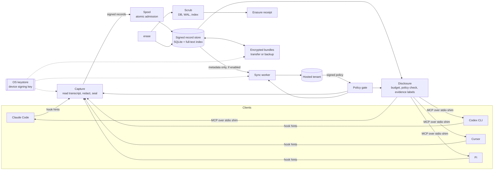

# telara-memory

[](https://github.com/Telara-Labs/telara-memory/actions/workflows/ci.yml)

> **Pre-release.** There is no tagged or signed release yet. Build from source, and read the
> [status table](#status) before relying on it.

telara-memory is a local, cross-client memory node for AI coding agents. It captures sessions
from Claude Code, Codex CLI, Cursor and Pi into one signed, erasable store on your machine, and
serves that memory back to any of those clients over MCP. It works with no account and sends
nothing off the machine by default. If you choose to, you can log in to a hosted tenant and turn
on metadata-only sync, which runs under a signed tenant policy.

## Why it exists

Coding agents forget. A decision made in a Claude Code session is gone when the session ends,
and it was never visible to the Codex or Cursor session you open next on the same repo. Each
tool keeps its own transcripts in its own format, and none of them reads the others.

Memory about your work should belong to you, not to whichever tool happened to record it. That
means three things.

- **One store across tools.** Every supported client writes into the same local record store and
  reads from it through the same MCP tools.
- **Provable erasure.** Deleting a record removes it and everything derived from it, scrubs the
  bytes from the database files, and returns a receipt that says whether the scrub finished.
- **You decide what leaves.** Nothing is pushed by default. Sync is opt-in, carries metadata only,
  and is limited to the repositories and record kinds you select.

## Features

Every item below is implemented in this repository. Paths are relative to `contract/`.

| Area | What it does | Where |
|---|---|---|
| Capture | Client hooks send identity and path hints only. The node reads the client's own transcript, redacts each full field before any truncation or hashing, then seals and signs it. Prompt injection is off. Memory is read only when an agent calls a tool. | `internal/node/capture`, `internal/node/clients` |
| Clients | Adapters and transcript decoders for Claude Code, Codex CLI, Cursor and Pi. The node never rewrites shared client config. It prints the MCP and hook snippets for you to merge, except for Pi, where it installs its own extension file. | `internal/node/clients` |
| Records | Strict canonical JSON, content-addressed ids, Ed25519 signatures, and causal key enrollment, rotation and revocation. Closed schemas reject unknown fields. | `jcs`, `record`, `sig`, `heads` |
| Store | A single-writer SQLite store (pure Go, no cgo) with full-text search, atomic spool admission and crash recovery. | `internal/node/store` |
| Read-back | A local MCP server over stdio with eight tools (`telara_task_list`, `_create`, `_resume`, `_checkpoint`, `_pause`, `_complete`, `telara_knowledge_search`, `telara_get_context`). Replies are byte-budgeted, re-checked against current policy before release, and labeled as evidence rather than instructions. | `internal/node/mcp`, `internal/node/mcpcatalog`, `internal/node/disclosure` |
| Erasure | `erase` removes exact records and their derived copies, physically scrubs database, WAL and full-text index bytes, and prints a receipt. Pending scrubs can be retried. | `internal/node/store/erase.go`, `scrub.go`, `internal/node/cmd/telara-memory/erase.go` |
| Key custody | The device signing key lives in the OS keystore, macOS Keychain or Linux Secret Service. There is no plaintext file fallback. A Windows Credential Manager backend exists but has not been run natively. | `internal/node/vault` |
| Local transport | A Unix domain socket (named pipe on Windows) with owner-only permissions and a kernel peer-identity check. There is no HTTP listener. | `internal/node/ipc`, `internal/node/peer` |
| Service | Installs a verified, content-addressed copy of the binary and registers it with launchd or systemd (Task Scheduler on Windows), with upgrade and uninstall. | `internal/node/install` |
| Bundles | Encrypted same-identity bundles using age. Transfer to a trusted device after a six-word code check, or back up to a passphrase. Private keys are never exported. | `internal/node/bundle`, `internal/node/cmd/telara-memory/bundle.go` |
| Sync | Optional, metadata-only push of session and task records to a hosted tenant, with DPoP-bound credentials, a TLS-pinned tenant policy root, and per-repository selection rules. | `internal/node/sync`, `internal/node/syncnode` |
| Tenant policy | Signed policy with rollback and tamper detection and trusted time. It can block repositories, force redaction, restrict push and read-back, and act as a kill switch. | `policy`, `internal/node/localpolicy` |
| Doctor | A read-only health report covering the key store, daemon reachability, hook trust, capture gaps, scrub state and sync blockers. | `internal/node/doctor` |

## Quick start

The pure contract module at `contract/` declares Go 1.25. The separate node runtime
at `contract/internal/node/` declares Go 1.26 and targets macOS or Linux. On macOS,
build with cgo enabled, the default with Xcode command line tools, because Keychain
custody refuses static builds.

This C1 source candidate has not completed actual Go 1.25 dependency resolution or
compiler validation. The runtime intentionally lacks its unpublished pure dependency
pin and cannot build yet. The runtime commands below apply after that exact published
dependency and its real checksums are adopted. No local replacement or workspace is
part of this boundary.

### Build

```sh
git clone https://github.com/Telara-Labs/telara-memory.git
cd telara-memory/contract/internal/node
mkdir -p "$HOME/.local/bin"
GOWORK=off go build -o "$HOME/.local/bin/telara-memory" ./cmd/telara-memory
```

### Install the node

`install` takes an absolute path to the binary, its lowercase SHA-256 and a version label. It
copies a verified image into the install directory, provisions the device key in the OS keystore,
starts the service and waits until it is ready.

```sh
BIN="$HOME/.local/bin/telara-memory"
SUM="$(shasum -a 256 "$BIN" | cut -d' ' -f1)"   # on Linux, sha256sum works too
"$BIN" install --source "$BIN" --sha256 "$SUM" --version dev
"$BIN" status
```

`--data-dir`, `--run-dir` and `--install-dir` override the default locations.

### Connect a client

```sh
telara-memory clients status
telara-memory clients install --client claude   # also codex, cursor, pi
```

For Claude Code, Codex CLI and Cursor, the command prints the MCP server and hook snippets and
the file each belongs in. Merge them yourself, since the node does not edit shared client
configuration. For Pi it installs a node-owned extension. Add `--print` to preview without
changing anything, and use `clients uninstall` to remove what was installed.

### Check health

```sh
telara-memory doctor          # human-readable
telara-memory doctor --json
```

`doctor` never starts the daemon, never changes the installation and never reads record content.

### Erase

```sh
telara-memory erase --id <record-id>              # asks you to type "erase"
telara-memory erase --id <id1> --id <id2> --yes --json
telara-memory erase --scrub-pending               # retry unfinished physical scrubs
```

`--reason` accepts `user_request` (the default), `redaction_miss`, `device_compromise` or
`retention_policy`. The command exits non-zero until the physical scrub is complete.

### Bundles, sync and removal

```sh
telara-memory bundle backup --id <record-id> --out backup.age   # passphrase read from stdin
telara-memory bundle restore --in backup.age --backup

telara-memory login --key                  # print the device key thumbprint to bind
telara-memory login < login.json           # login document on stdin, never in argv
telara-memory sync select --id my-rule --repo <repo-id> --kinds session,task
telara-memory sync status
telara-memory logout

telara-memory uninstall
```

Device-to-device transfer uses `bundle invite`, `join`, `add-device` and `enroll`, then
`bundle export --to <device-key-id>`.

### Hosted enrollment bridge

`telara-memory login --hosted` accepts an existing human sign-in and an owned
bootstrap credential through standard input with explicit `consent` and
`memory_only` values, selected repository IDs, operations and an expiry. It
obtains the installed signed genesis and uses the native device DPoP key. It
refuses redirects and validates the returned grant and authenticated tenant
policy before storing the refresh credential in the OS vault.

This operator bridge does not provide browser signup or device authorization.
The hosted endpoints require deployment and acceptance before use.

## Architecture



- **Capture** never depends on the agent calling a tool. Hooks only point at a session, and the
  node reads and redacts the transcript itself.
- **The store** is the single writer. Clients reach it through a stdio shim that connects to the
  daemon over a local socket, which checks the peer's identity in the kernel.
- **Disclosure** decides what text may leave the store for a given request, under current policy
  and erasure state, and labels it as untrusted evidence.
- **Erasure** propagates to derived records, bundles and staged sync data before it is
  acknowledged.
- **Sync** pushes only allowlisted session and task metadata. Full bodies never leave.

The pure record contract (canonical encoding, records, signatures, policy, replay and bundle
rules) lives in the packages at the top of `contract/` and has no database or node dependencies.
The runtime has its own module under `contract/internal/node/`, including the CLI,
client acceptance harness, release builder and npm staging tool. The public contract
import paths, embedded fixtures, conformance command and `releaseauth` stay in the
pure module. Interpretation notes are in
[`contract/OPEN-QUESTIONS.md`](contract/OPEN-QUESTIONS.md).

## Security model

- Records are canonical, content-addressed and signed. A record, key operation or policy without
  a valid signature from an authorized key is refused.
- The signing key is held by the OS keystore. If the keystore is unavailable, custody is refused
  rather than falling back to a file.
- The local socket and data directories are owner-only, symlinks are refused, and peers are
  checked by kernel identity, not by anything they claim.
- Recalled content is presented to agents as evidence, never as instructions.
- Redaction runs on full fields before anything is stored or sent.
- The only network client in the node is the sync worker, which does nothing until you log in.
  Tenant policy on the node is cooperative. The hosted service is the enforcing boundary.

Report vulnerabilities privately as described in [SECURITY.md](SECURITY.md).

## Status

This is a **pre-release**. The code is under active hardening, and the hosted side is not yet
serving.

| Verified | Evidence |
|---|---|
| Targeted security checks | Current candidate CI passes offline erasure, quarantine arrival orders, shared redaction corpus, governed task bundle and signed-release verification. Full platform and race suites remain pending. |
| Conformance vectors | Go vector registry plus an independent Python checker for V1 to V7 (RFC 8785, Ed25519) |
| Fuzzing | Fuzz targets for every client decoder, hook parsing, records, keys, policy and framing, run on macOS and Linux with no crashes |
| Native key custody | macOS Keychain lifecycle, and GNOME Keyring through Secret Service on Linux |
| Local socket attack | Linux test with a second user attacking the daemon socket, run directories and data paths, all refused |

| Not yet done | Notes |
|---|---|
| External penetration test | Not started |
| Native Windows runs | Windows tests run in CI; service registration and Credential Manager custody have not been exercised on a real install |
| Real-client runs | Codex CLI has created and read back memory through an installed node. Claude Code, Cursor and Pi runs through the same harness are pending |
| Release signing | Verification and signing code are implemented. No signed release artifacts have been produced yet. |
| Hosted endpoints | Sync and login are implemented on the node, but the hosted service is not live |
| Module split validation | The source boundary is assembled. Actual Go 1.25 dependency closure/compiler proof and the published pure dependency pin for runtime are pending |

Other Linux secret stores (KWallet, KeePassXC) and real desktop sessions are also untested.

After dependency resolution, run the pure checks from `contract/`. The nested node
module is excluded from this `./...` inventory.

```sh
GOWORK=off go test ./...
GOWORK=off go vet ./...
GOWORK=off go run ./cmd/conformance --pure
python3 conformance/python_vectors.py   # after installing conformance/requirements.txt
```

Run the node checks separately from `contract/internal/node/` after its exact pure
dependency is pinned.

```sh
GOWORK=off go test ./...
GOWORK=off go vet ./...
```

From `contract/`, full registry dispatch names both module roots explicitly.

```sh
GOWORK=off go run ./cmd/conformance --root . --node-root ./internal/node
```

Pure mode retains all 20 runtime registry entries as `NOT_RUN` and never counts
them as pure tests. The full command dispatches those exact entries in the explicit
node module. Storage and transport gates remain `INCOMPLETE` until they have adapter
proof, and the command exits with status 2 without `--pure` while any remain.

## Authenticate a release

Release verification uses the project Ed25519 public key compiled into the
executable. An installation from a release directory selects the current
platform artifact and checks its digest against the authenticated manifest.

```sh
telara-memory verify-release --dir /absolute/path/to/release
telara-memory install --release-dir /absolute/path/to/release
telara-memory upgrade --release-dir /absolute/path/to/release
```

`--release-dir` refuses simultaneous `--source`, `--sha256` or `--version`
overrides. Independent SHA256 values alone do not authenticate their source.
This mechanism does not establish macOS notarization or Windows Authenticode
signing. Current platform acceptance and publication remain release gates.

Maintainers build from an exact clean version tag with Go 1.26.1. The private
PKCS8 Ed25519 signing key stays outside the repository. Development builds
cannot be signed or claim clean-tag release provenance.

```sh
cd contract/internal/node
go run ./release --source /absolute/path/to/repository --tag vX.Y.Z \
  --out /absolute/path/to/new-release --signing-key /private/path/release-key.pem
go run ./release --verify /absolute/path/to/new-release
```

## License

Apache License 2.0. See [LICENSE](LICENSE).
